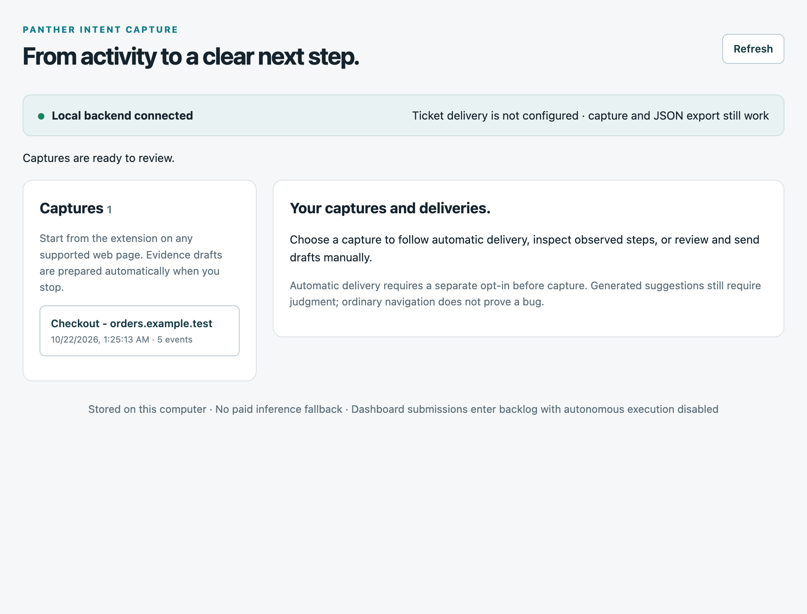
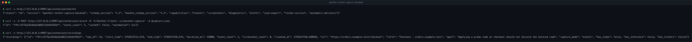

# Panther Intent Capture

[](https://github.com/hamanakam1/panther-intent-capture/actions/workflows/ci.yml)
[](https://opensource.org/licenses/MIT)
[](https://developer.chrome.com/docs/extensions/mv3/)
[](https://www.python.org/downloads/)
[](https://github.com/hamanakam1/panther-intent-capture)
[](https://github.com/hamanakam1/panther-intent-capture/releases)

```text
        ⠀⠀⠀⠀⢀⣠⣤⣤⣤⣤⣤⣤⣤⣤⣄⠀⠀⠀⠀
        ⠀⢠⣿⣿⣿⣿⣿⣿⣿⣿⣿⣿⣿⣿⣿⣷⡀⠀⠀
        ⠀⣿⣿⣿⣿⣿⣿⣿⣿⣿⣿⣿⣿⣿⣿⣿⣷⠀⠀
        ⠀⣿⣿⣿⣿⣿⣿⣿⣿⣿⣿⣿⣿⣿⣿⣿⣿⠀⠀
        ⠀⣿⣿⣿    (o)   (o)    ⣿⣿⣿⠀⠀
        ⠀⣿⣿⣿        △        ⣿⣿⣿⠀⠀
        ⠀⠹⣿⣿⣿⣿⣿⣿⣿⣿⣿⣿⣿⣿⣿⠏⠀⠀
        ⠀⠀⠙⢿⣿⣿⣿⣿⣿⣿⣿⣿⣿⣿⠏⠀⠀⠀

   ┌─────────────────────────────────┐
   │     PANTHER INTENT CAPTURE       │
   │                                 │
   │     (panther watches browser)    │
   │                                 │
   └─────────────────────────────────┘
```

Turn a browser session into a clear, reviewable request for improvement.

Panther records the interactions you choose to capture, keeps the evidence on your computer, and turns intent into tickets. Configure a compatible local ticket service and opt into automatic delivery for a session to save, generate, deliver, and verify without a separate click for each ticket. Or use manual review and JSON export without any destination. **Panther creates tickets; it does not implement the work.**

The current implementation targets Chrome and Microsoft Edge 116+ with a Manifest V3 extension and a small Python backend. Browser-controlled backend startup is packaged for macOS and Linux; Windows helper packaging remains unimplemented. Capture works on ordinary `http` and `https` pages that allow extension injection. You do not need to add each website to the manifest. Browser settings pages, extension stores, embedded frames, and native desktop applications are outside the supported capture scope.

## What it looks like

Both screenshots below are the real product, not a mock-up.
[`scripts/capture_screenshots.py`](scripts/capture_screenshots.py) starts the
actual backend, records a synthetic capture through the actual API, and
photographs the actual options page with a real browser. The origin, the page
and the ticket data are fictional, so nothing here identifies a real system.

The options page, with the local backend connected and one capture waiting to
be reviewed:



The three API calls behind it — the health check, the capture, and the listing:



## What works in this version

- **Toolbar dashboard:** a stable 400-pixel popup keeps power, capture state, the chosen page, captured goal, counts, and the next action together. Recent captures lead to review; capture options and helper details expand when needed. Off remains visible while scrolling. Opening the popup never starts capture or turns on its backend. Older workers that do not provide a goal are identified explicitly.
- **Chosen-tab capture:** start from the extension popup; record clicks, changes, submissions, and navigation within that tab's origin. Capture starts off. Typed values, typed keys, and full page text are excluded.
- **Persistent status window:** explicit On opens a small separate browser window showing runtime state, capture counts, generation and delivery progress, and when status was last confirmed. Off stays reachable while work is running. **Open status window** in the popup reopens or focuses it without turning Panther on. Closing it hides the view; it does not stop Panther. It is a normal window, not an always-on-top overlay.
- **Live activity understanding:** while capturing, the window shows recent actions, a rules-based interpretation, and possible friction tied to numbered evidence. Optional **Live local AI insights** can interpret new observations using your configured local model, with separate opt-in, bounded refreshes, and visible uncertainty. Observations, hypotheses, and saved tickets remain distinct; insights never send tickets or execute work. See [live activity behavior and limits](docs/LIVE_ACTIVITY.md).
- **Page-reported failures:** while capturing, Panther also records what the page itself said went wrong — an uncaught exception, an unhandled promise rejection, an HTTP error response, or a subresource that failed to load — in the same ordered timeline as your interactions. A draft can then name a cause instead of only a symptom. A failure is an observation of what the page said, never a verified defect, a reproduction, or permission to act. See [session diagnostics and their limits](docs/SESSION_DIAGNOSTICS.md).
- **Possible friction in the ticket:** Panther derives hypotheses from the recorded actions — repeated clicks on one control, and clicks on an element the page never marked as a control. These now reach the draft and the export, not only the live status window. They are possibilities, never confirmed defects. See [session diagnostics](docs/SESSION_DIAGNOSTICS.md).
- **Replay plans:** a capture can be exported as a versioned, destination-neutral plan of the path that was taken, with a stable handle for each control, the recorded failures and the friction signals, and an optional Playwright rendering. Panther never runs a plan, and a plan never contains a typed value. See [replay plans](docs/REPLAY_PLAN.md).
- **Chosen-page controls:** the compact toolbar popup, recording badge, and floating page panel show capture status. The panel can stop capture and open the drafts. Hiding the panel does not stop capture.
- **Explicit browser On / Off:** the popup starts Panther's own backend through a one-time registered local helper. Off stops capture, cancels remaining automatic delivery, and shuts down that backend. No login startup, background service installation, or automatic reconnect.
- **Optional screenshots:** opt in separately for each session to collect up to five screenshots at click or submission points. Screenshot pixels are **not redacted**; inspect them before sharing.
- **Evidence drafts without a model:** stopping saves the capture and prepares a draft from observed actions and your stated goal. This does not infer that a bug exists.
- **Optional local AI:** explicitly choose **Generate with local AI** for proposed intents and task decomposition using your configured local Ollama model. No paid or remote inference fallback is used.
- **Human review:** inspect events and any screenshots, edit the title, problem statement, and acceptance criteria, and save draft edits locally.
- **Local ticket delivery:** preview the exact ticket, then confirm one draft at a time. The adapter creates a backlog ticket with `no-auto`, preserves capture identity for retries, and independently reads it back before showing verified delivery.
- **Opt-in end-to-end automation:** while Panther is on, choose automatic delivery to the displayed local ticket service destination before Start. After Stop, Panther saves the capture, generates unreviewed proposals, delivers up to five, and verifies each ticket. If generation exceeds the cap, the whole job blocks before sending. Progress, retry timing, counts, and cancellation are visible. Bounded retries reuse the same identities; turning Panther off cancels remaining automatic delivery.
- **Portable JSON:** export the same draft and provenance for another tool. Additional destinations need an adapter or importer; GitHub, Jira, Linear, and arbitrary native apps are not built-in integrations yet.

Video capture, audio capture, and media playback are disabled in this release. Legacy media files in the repository are not a supported capture path. Firefox and Safari manifests are experimental placeholders, not supported browser builds.

## Working beside Panther Companion

Use the status window as a readable capture rail, then use the searchable review desk to check events and page-reported failures, edit expected outcomes, and export a portable intent bundle. **Copy intent bundle** and **Download intent bundle** prepare the existing schema `1.2` content for explicit preview and import in Companion; neither sends it automatically. Both tools remain useful on their own. See [the Companion workspace guide](docs/COMPANION_WORKSPACE.md) for the capture → review → next-action workflow and a practical ultrawide layout.

## Quick start

You need Python 3.11+, macOS or Linux, and Chrome or Edge 116+ for browser-controlled operation. The core backend uses Python's standard library; no package installation or Ollama service is needed for evidence drafts. There is no login service to enable and no terminal to keep running after helper setup.

Load the extension:

1. Open `edge://extensions/` or `chrome://extensions/`.
2. Enable **Developer mode**, choose **Load unpacked**, and select this repository's `extension/` directory.
3. Copy Panther's extension ID and perform the one-time [browser helper setup](docs/BROWSER_CONTROL.md). Pin Panther in the browser toolbar. The default `extension/manifest.json` works for both supported browsers; no manifest swapping is needed.
4. Open an ordinary website you have permission to capture. Open Panther and click **Turn on**. A separate status window opens and shows **On / Idle** after native startup is confirmed. This starts its backend, not capture; it does not start a destination service or Ollama. The window stays available while you switch tabs.
5. Return to the chosen webpage and open Panther's toolbar popup, enable capture consent, and write a short goal in **What outcome do you want?** Keep screenshots off unless you want to retain visible page pixels. The status window cannot start capture or grant consent.
6. For an automated session, configure a compatible destination, open **Capture options**, enable **Deliver draft tickets automatically**, and check the displayed destination. Optionally enable local AI; otherwise evidence-only generation needs no model. These choices apply only to this session.
7. Click **Start capture**, reproduce the workflow, then stop using the popup, floating panel, or status window. With automation enabled, saving, generation, delivery, and independent verification run automatically; watch the status window's activity, counts, and freshness timestamp. Delivery counts describe the last verified receipts, not continuous destination health. You can cancel remaining delivery, but not undo tickets already submitted.
8. With automation off, click **Review saved drafts**, check the observed steps, describe the problem or improvement, and add a verifiable expected result. Choose **Save draft edits** before exporting JSON, or **Preview ticket delivery**, then **Send this reviewed ticket** for manual delivery to your configured destination.
9. When finished, click **Turn off** in the toolbar popup or **Turn Panther off** in the status window. The window stays open to show confirmed shutdown. This preserves saved evidence and interrupted local captures, cancels remaining automatic delivery, and stops the browser-owned backend. Already sent tickets and in-flight requests cannot be undone. Quitting the browser process also stops the helper; closing only a window may leave the browser running in background. The next On requires a fresh capture start.

Capture stops when you leave the chosen origin, close the tab, revoke capture consent, or reach the event limit. Same-origin reloads and SPA navigation are supported. A browser restart leaves an interrupted capture available for recovery rather than resuming recording automatically.

Automation is bounded, not unattended surveillance: it never turns Panther on or starts capture by itself. **Stop & deliver** leaves Panther on so the admitted workflow can finish; **Turn Panther off** cancels remaining delivery. Reopening the popup or browser does not resume it. See [browser controls](docs/BROWSER_CONTROL.md) and [automation behavior and limits](docs/AUTOMATION.md).

## Local ticket delivery and other systems

There is no default ticket destination. Configure a loopback origin with `--dashboard-url` during helper setup, or `PANTHER_DASHBOARD_URL` for a manually launched backend. The service must already be running and implement the specific [ticket-service protocol](docs/INTEGRATIONS.md#local-ticket-service-adapter); changing the origin does not make this a universal adapter. The extension never writes directly to the destination. Panther does not install, restart, or change other services. Capture, review, and JSON export remain available without a configured destination.

A second destination is available: **GitHub issues**, configured with `PANTHER_GITHUB_TOKEN` and `PANTHER_GITHUB_REPO` on the backend. It is a remote destination, so it is off until it is configured, it needs its own credential, and its target is frozen for a session the moment consent is given. The local ticket service stays loopback-only. See [the GitHub destination](docs/GITHUB_DESTINATION.md).

Submitted tickets contain a bounded summary of intent, observed evidence, reproduction steps, acceptance criteria, source URL, timestamps, and provenance. Media references are not uploaded screenshot attachments. Automatically delivered tickets are **unreviewed proposals**, not verified bugs. Sending a draft grants no permission to execute it: tickets enter backlog with the `no-auto` review fence.

### Intent bundle

For another system, use **Export JSON** and map the versioned intent bundle into that system's own draft or issue format. The capture and review workflow is independent of the destination. See [integration contracts and adapter guidance](docs/INTEGRATIONS.md) for the export shape, HTTP routes, retry behavior, and configuration.

Use the [formal intent-bundle JSON Schema](schemas/intent-bundle.schema.json) to validate an importer against the supported version 1.2 contract. Schema validation does not verify a proposed bug or authorize execution.

### Updating the installed source

Source files, the loaded browser worker and the running local backend can have different versions. The toolbar reports them separately. New capture starts require the updated worker's status contract; the review desk stays read-only until the running backend confirms saved-edit persistence and intent bundle 1.2 support. A manual HTTP review workspace only needs a compatible backend. Status checks do not restart services, reload the extension or grant capture consent.

Finish capture → Off → reload extension → On, then Refresh. Retry any retained upload before starting another capture. Review existing automatic-delivery receipts separately: an older session's frozen proposal may require fresh review or consent after an update. No update automatically resumes delivery or authorizes execution.

## Local AI and configuration

Browser-controlled operation stores configuration during [helper setup](docs/BROWSER_CONTROL.md); use the installer's `--dashboard-url`, `--data-dir`, `--ollama-endpoint`, and `--ollama-model` arguments. The following environment variables apply to the developer-only manually launched backend.

| Variable | Default | Purpose |
|---|---|---|
| `PANTHER_DATA_DIR` | `~/.panther-intent-capture` | Private capture, draft, and receipt storage. |
| `PANTHER_DASHBOARD_URL` | Unset; delivery disabled | Explicit compatible ticket-service loopback HTTP(S) origin. Remote addresses and redirects are rejected. |
| `OLLAMA_ENDPOINT` | `http://127.0.0.1:11434/v1` | Local OpenAI-compatible inference endpoint. A loopback HTTP address is required. |
| `OLLAMA_MODEL` | `qwen3.8-hermes:latest` | Model name used only when local AI generation is explicitly requested. It must already be available on your computer. |
| `EXTENSION_BACKEND_PORT` | `7890` | Backend listener port. The shipped extension expects `7890`; changing this also requires updating its backend origin and host permission. |

For example, choose an already installed local model when starting the backend:

```bash
OLLAMA_MODEL=your-installed-model python3 backend/server.py
```

An unavailable model or invalid model response produces a visible generation error and keeps the saved capture available. You can retry or use the evidence draft. Current event-only capture does not promise visual analysis of the optional screenshots; provenance records whether media was actually analyzed.

## Privacy, retention, and recovery

Panther captures a small allowlist of control metadata instead of input values or keystrokes. URL sanitization removes credentials and query parameters; text sanitization removes common secret patterns. These filters reduce exposure but do not guarantee that every identifier, control label, user-written goal, or screenshot is free of private information.

Page failures are captured under the same rules. A failure carries a bounded, redacted message, a sanitized location, and an HTTP status where one applies. There is no stack trace, no console output, and no page text. A page controls its own error stream, so a failure is an observation of what the page said and never a verified defect.

Screenshots require separate consent and may include any visible content in the chosen tab. They are stored locally for review. JSON exports and dashboard summaries contain evidence references rather than image data.

While recording, the browser persists capture state so the extension service worker can restart. If the backend is unavailable at Stop, Panther shows **Upload pending** and keeps the capture in browser storage. Use **Retry upload** after starting the backend; the same session identity prevents a second recording. **Discard unsaved capture** removes that browser copy. Generation failure has a separate retry because the recording may already be saved.

While Panther is on, opted-in automated sessions also retry stopped uploads automatically, with a bounded retry budget and expiry. After the upload is admitted, a durable backend job owns generation and delivery, even if the popup closes. It freezes the destination, model mode, ticket limit, and draft payloads. Turning Panther off or losing the native connection cancels remaining delivery; the next explicit On cancels any stale unfinished jobs before starting the worker. Later edits cannot silently change an in-flight delivery. Status failures show unknown/stale information rather than success; verification timestamps describe the last confirmed delivery, not a continuous check of Dashboard state.

Backend captures have a 30-day retention limit and a cap of 200 records, enforced when storage is accessed. **Delete capture** removes its local capture artifacts, saved drafts, and automation job. It stops remaining delivery, but cannot retract a request already in flight. It does not remove downloaded exports, browser consent history, already submitted dashboard tickets, or delivery receipts. Receipts retain capture identity, a content hash, target, ticket ID, and delivery state to prevent duplicate submissions; they do not retain the full captured evidence. Content-free cancellation markers prevent late uploads from reviving withdrawn delivery consent; their expiry is documented in the [automation contract](docs/AUTOMATION.md).

The backend binds to `127.0.0.1`. Its origin and request-header checks are browser request protections, not user authentication. Treat this as a local single-user tool; do not expose the port publicly or use the header as an access token.

## Development and verification

For backend-only development, `python3 backend/server.py` (or `bash backend/start.sh`) starts a manual server and local review page at `http://127.0.0.1:7890/`. Stop it with Ctrl-C. The extension will not adopt or stop a manually launched server; stop that server before using browser On / Off.

Run the focused synthetic test suites from the repository root:

```bash
node --test tests/*.mjs
python3 -B -m unittest discover -s tests -p 'test_*.py'
```

The Python tests use temporary data directories and fake loopback dashboard/inference servers. The JavaScript tests exercise capture state and redaction with browser API doubles. Passing them does not establish that the unpacked extension has been installed and exercised in a real browser, that a particular local AI model works, or that a live local ticket service ticket has been accepted. Those are separate checks using a harmless, consented capture and explicit manual or session-level delivery authorization.

The optional test-only `jsonschema==4.26.0` dependency enables full export-schema validation; CI installs it explicitly. Without it, validator cases report skips. See [contributor verification instructions](CONTRIBUTING.md#unit-tests).

See the [1.4.0 status-window verification](docs/STATUS_WINDOW_TEST_RESULTS.md) for current test totals, loaded-Chromium observations, and remaining personal-browser checks. The [1.3.0 browser-control verification](docs/BROWSER_CONTROL_TEST_RESULTS.md) records On/Off, native-process, and shutdown-race evidence. The [1.2.0 report](docs/AUTOMATION_TEST_RESULTS.md) records earlier automation and recovery checks, and the [1.1.0 report](docs/TEST_RESULTS.md) preserves manual-workflow and local-model checks. Build an unpackable Chromium ZIP with `python3 scripts/package_extension.py`; CI also retains it as an artifact.

See [ROADMAP.md](ROADMAP.md) for remaining work, [CONTRIBUTING.md](CONTRIBUTING.md) for contributing, and [SECURITY.md](SECURITY.md) for vulnerability reporting.

## License

[MIT](LICENSE)

 
Wed Oct 21 13:39:56 PDT 2026
# 
<!-- Updated -->

 
 
